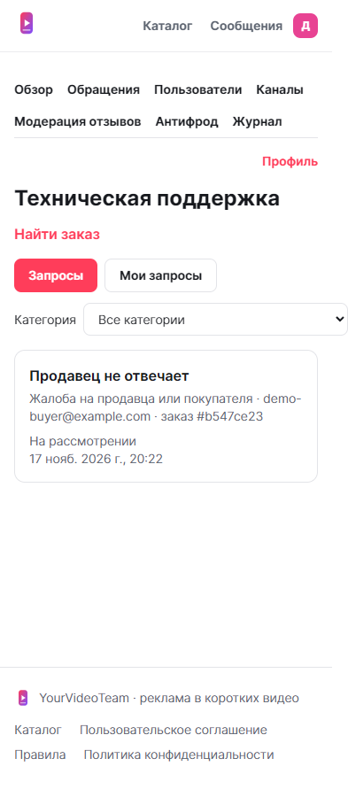

# Аудит локальной Beta-tex — 17 ноября 2026

## Итог и ограничения изменений

Обнаружены ошибки обработки жалоб по сеткам, обход нового порядка арбитража через старый API, конфликт интересов поддержки, отсутствие автоматического обновления карточки арбитра, ошибка валидации апелляции и переполнение мобильного экрана. Есть риски локальной сетевой конфигурации, ограничения защиты от нагрузки и уязвимые зависимости инструментов разработки.

Исправлений не внесено. Исходники, существующие документы, настройки и ветки не изменялись. В Beta-tex добавлены только этот отчёт и иллюстрация к нему. Старые документы и их исторические результаты сохранены. Коммитов, push и публикаций в Vercel нет.

До переноса в beta следует исправить как минимум потерю позиций жалобы и обход арбитража, затем проверить конфликт интересов и остальные перечисленные ошибки.

## Что именно проверено

- Рабочая копия: ProMarketing-beta-tex, локальная ветка Beta-tex, база ветки — 986e259d4d0729d667e767ac4347681f22980a33. Проверялись и незакоммиченные изменения текущей рабочей копии.
- Актуальный GitHub main: 7517bf655790ddecf8c4de67652a283c51e57e00. Актуальная beta: 986e259d4d0729d667e767ac4347681f22980a33.
- Деревья файлов этих main и beta идентичны: c8397c5eeca2dc5e7861f17ed14e325087d1bc46. Коммиты разные, содержимое совпадает. Локальный origin/main был старее; для аудита использован актуальный коммит без переключения или обновления веток.
- Прочитаны все 125 Markdown-файлов каждого опубликованного дерева и 126 Markdown-файлов рабочей Beta-tex, включая документацию и проектные скиллы. Проверены исходники и конфигурация проекта, затем отдельно исследованы затронутые бизнес-правила.
- Штатный стенд localhost:3000 не использовался для создания тестовых заказов, пользователей и жалоб. Проверки с изменением данных выполнялись на отдельной базе yvt_audit_20261117r1 и временных контейнерах с исходниками, подключёнными только для чтения.
- Для самостоятельного нагрузочного повтора поднят отдельный PostgreSQL. Браузерные запросы перенаправлялись на тестовый API, внешний платёжный и социальные провайдеры заменены штатными mock/fake.
- В функциональном тестовом API лимиты повышены для последовательного прохождения множества сценариев. Проверки ограничений частоты выполнялись на отдельном API со штатными лимитами. Настройки штатного стенда не менялись.
- Содержимое пользовательского .env, секреты и реальные OAuth-токены не читались. Реальные платежи не выполнялись.

## Результаты готовых проверок

| Проверка | Результат |
| --- | --- |
| Полный pytest | 193 passed, 135,58 с |
| Vitest | 9 passed |
| ESLint | Без ошибок |
| Ruff --no-cache | All checks passed |
| Django check | Ошибок нет |
| makemigrations --check --dry-run | Изменений схемы нет |
| git diff --check | Ошибок нет |
| Основные браузерные наборы | 13 из 14 прошли |
| Отдельный сценарий BETA_MODE=true | Прошёл |
| Готовность штатного API после проверок | database=ok, cache=ok |

Прошли smoke, auth, security, accounts, catalog, order, dispute, staff, staff-customization, support, insights, profile, journey и отдельно beta. Набор responsive завершился ошибкой на /staff/tickets при ширине 375 px.

Пользовательский путь journey прошёл: главная → каталог → фильтрация → объявление → вход → личное сообщение продавцу → уведомление продавца → ответ → заказ и оплата → принятие и публикация → подтверждение и отзыв → покупки.

Сценарий beta дополнительно проверил объединение личной переписки и заказа в одном диалоге, отсутствие повторной строки собеседника, исходное ТЗ, получение сообщений без перезагрузки, вызовы звука сообщения и заказа, принятие заказа и мобильный экран.

Успех готовых тестов не означает отсутствия ошибок: следующие сценарии дополнительно воспроизведены вне этих наборов.

## Подтверждённые ошибки

### F-01. Высокий приоритет: встречная жалоба теряет часть позиций сетки

Место: backend/support/services.py:118–132, ветка if active в open_dispute.

Воспроизведение:
1. Оплатить сетку минимум из двух аккаунтов; продавец принимает позиции.
2. Покупатель открывает жалобу только по первой позиции.
3. Продавец отправляет встречную жалобу по первой и второй позициям.

Факт: оба POST вернули 201, второе обращение присоединилось к тому же делу. В DisputeItem осталась только первая позиция. Запрос содержал две позиции, сохранена одна.

Последствие: сотрудник видит текст претензии о двух позициях, но рассмотрение и приостановка выплаты не охватывают вторую. Это влияет на денежные решения по сеткам.

Ожидание: все заявленные позиции должны быть корректно учтены либо запрос должен быть явно отклонён с объяснением, какие позиции не включены. Молчаливое принятие неполной жалобы недопустимо.

### F-02. Высокий приоритет: старый API обходит новый порядок арбитража

Места: backend/support/views.py:120, :241; backend/support/services.py:100, :372.

Воспроизведение:
1. Покупатель создаёт жалобу через POST /api/v1/orders/{order}/disputes/open.
2. У нового дела intake_category пустая, referred_at отсутствует, assignee не назначен.
3. Пользователь с ролью admin, без arbitration.work, открывает /staff/disputes/{id} и отправляет full_refund в /decide.

Факт: создание 201, просмотр 200, решение 200; финансовое действие получило status=done. Передачи арбитражу и назначения арбитру не было.

Причина: проверки нового порядка условны и обходятся для дела с пустой intake_category.

Это нарушение разграничения нового рабочего процесса. Для эксплуатации в проверенном сценарии требовалась роль администратора с finance.refund; возврат обычным покупателем или анонимом не получен. Денежная операция была тестовой.

Ожидание: правила передачи, роли и назначения должны одинаково действовать для всех доступных путей создания дел.

### F-03. Средний приоритет: поддержка может закрыть жалобу на самого себя

Места: backend/support/services.py:221 и :270; backend/support/tickets.py:StaffTicketAction.

Воспроизведение: продавцу выдана роль support_agent; покупатель подаёт жалобу на его заказ; продавец как сотрудник берёт эту жалобу и закрывает её.

Факт: assign=200, close=200, status=closed. Для арбитра собственное участие в заказе проверяется, для поддержки аналогичного ограничения нет.

Последствие: сотрудник, одновременно являющийся продавцом, может прекратить рассмотрение претензии к себе и снять связанное с ней ограничение спорных позиций без независимого сотрудника. Это риск злоупотребления служебной ролью, а не возможность любого покупателя.

### F-04. Средний приоритет: карточка арбитра не получает новые сообщения автоматически

Место: frontend/components/StaffComplaint.tsx:28–29. Загрузка выполняется при открытии, механизма опроса или подписки нет.

Воспроизведение: назначенный арбитр открывает дело; после этого покупатель добавляет ответ по жалобе.

Факт: покупатель увидел отправленный ответ. В открытой карточке арбитра сообщения не было после ожидания 12 секунд; после reload оно появилось.

Последствие: арбитр может принять решение, не увидев последние пояснения. Для сообщений и новых доказательств требуется автоматическое обновление либо явный механизм уведомления о новых данных. Проверка стандартного пользовательского чата при этом прошла.

### F-05. Средний приоритет: неверный тип reason в апелляции вызывает 500

Места: backend/support/views.py:Appeal, backend/support/services.py:181–184.

Воспроизведение: авторизованный участник отправляет POST /api/v1/disputes/{id}/appeal с JSON {"reason":{"bad":"type"}}.

Факт: HTTP 500 воспроизведён и через APIClient, и обычным HTTP-запросом с реальной сессией и CSRF. Код вызывает strip у объекта до проверки бизнес-состояния дела.

Ожидание: HTTP 400 с ошибкой поля. Для аналогичных неверных типов в сообщении чата и создании обращения получен корректный 400. Раскрытия трассировки клиенту при DEBUG=false не обнаружено.

### F-06. Средний приоритет: очередь поддержки шире мобильного экрана

Место: frontend/components/SupportTickets.tsx:66–67.

Факт: /staff/tickets, viewport=375 px, ширина документа=393 px, горизонтальное переполнение=18 px. Выпадающий список имеет ширину 299 px, строка с подписью «Категория» — около 376,84 px и не помещается в доступную область.

Это воспроизведённый сбой готового responsive.cjs. Остальные проверенные страницы этого набора ошибок не дали.

## Безопасность, нагрузка и зависимости

### S-01. Доступ к чужим данным: выполненные проверки выдержаны

- Аноним: /me, /staff/users, /support/tickets, частный заказ — 403.
- Другой обычный пользователь: чужой заказ, его чат и споры — 404; служебные пользователи и арбитраж — 403.
- Синтетический корректный PNG: загрузка 201, владелец скачивает с 200, посторонний пользователь получает 404. Повреждённое изображение отклонено с 400.
- Изменение профиля без CSRF — 403; с корректным токеном, но посторонним Origin — 403.
- Попытка добавить себе roles=super_admin, is_staff и is_superuser через /me не дала прав; учётная запись осталась buyer. HTTP 200 означает игнорирование недоступных полей, а не повышение прав.
- Поддельная подпись платёжного webhook — 400.
- Строка SQL-инъекции в поиске обработана как поисковый текст без ошибки.
- Синтетический сохранённый XSS в bio показан текстом; обработчик не выполнился, контрольная переменная осталась 0.
- Сообщение длиннее лимита — 400.
- Готовые тесты дополнительно прошли проверки 2FA, идемпотентности заказов и платежей, повторных возвратов, сканирования файлов и конкурентных операций.

Это результаты конкретных проверок, не доказательство невозможности любой кражи данных.

### S-02. Локальный Docker публикует БД и Redis на всех интерфейсах

Места: infra/docker-compose.yml:13 и :21.

Docker показывает 0.0.0.0 и [::] для портов 5432 и 6379. Redis ответил +PONG на обычное соединение к 127.0.0.1:6379 без аутентификации. Для PostgreSQL в dev-compose используются опубликованные в репозитории учётные данные.

Если эти порты доступны из локальной сети через правила Windows Firewall, появляется путь к данным в обход сайта и его ролей. Доступ с другого компьютера или из интернета не проверялся. Это подтверждённая конфигурация локального dev-стенда; вывод не переносится автоматически на Vercel или production-compose.

Предпочтительное направление исправления: ограничить dev-порты loopback либо убрать ненужную публикацию, отдельно проверить правила сети.

### S-03. Ограничения частоты и ограниченная нагрузка

| Прогон | Результат |
| --- | --- |
| Неверный пароль, 15 запросов, каждый с другим X-Forwarded-For | Первые 10 — 400, следующие 5 — 429 |
| Последовательные 350 запросов каталога | 300 ответов 200, затем 50 ответов 429; первый отказ на запросе 301 |
| 340 запросов каталога, максимум 8 одновременно, отдельный PostgreSQL | Все 340 — 200, 5,91 с, p50=118,4 мс, p95=178,5 мс, максимум=812,2 мс |
| Такой же параллельный прогон при общих ресурсах локального PostgreSQL | 336 ответов 200, 4 ответа 500; после нагрузки ready=ok |

Защита от перебора пароля работает, подмена X-Forwarded-For в dev её не обошла. Последовательный лимит каталога работает. При конкурентных запросах лимит 300/min не оказался строгим: весь пакет 340 запросов прошёл менее чем за 6 секунд. DRF использует последовательность чтения и записи истории в Redis, поэтому этот механизм нельзя считать полноценной защитой от DDoS.

Причина четырёх 500 подтверждена логом: PostgreSQL сообщил FATAL: sorry, too many clients already. В этот момент общий сервер имел 15 idle-соединений штатной базы и 75 idle-соединений тестовой базы. При повторе с отдельным PostgreSQL ошибок не было. Следовательно, это наблюдение об исчерпании общих ресурсов локального стенда; оно не доказывает, что восемь запросов сами по себе валят сервис или что production ведёт себя так же.

Распределённая атака, пропускная способность сети, slowloris, длительное истощение ресурсов, массовые загрузки и атака на провайдеров не выполнялись. Атаки на публичный Vercel не проводились. Статус «защищён от DDoS» по этому аудиту присвоить нельзя.

### S-04. Зависимости frontend: production без найденных advisory, инструменты разработки требуют внимания

- npm audit --omit=dev: 0 известных уязвимостей.
- Полный npm audit: 18 проблемных пакетов, из них 2 critical, 10 high, 6 moderate по классификации npm. Это количество пакетов с проблемами, а не 18 независимых CVE.
- Затронуты в том числе Vitest/tinypool, @vitest/mocker и цепочки инструментов ESLint/glob.
- Эти результаты относятся к зависимостям разработки/тестирования. Удалённое выполнение кода через обычный сайт не продемонстрировано. Требования к эксплуатации и область воздействия различаются.

Первичные описания условий: [tinypool — влияние на worker и CI](https://github.com/tinylibs/tinypool/security/advisories/GHSA-5gmw-xhrv-c9v3), [Vitest/mocker — область применимости чтения файлов](https://github.com/vitest-dev/vitest/security/advisories/GHSA-82fw-gwwq-j7x9).

npm audit fix, обновление пакетов и изменение lock-файлов не выполнялись. Автоматическое предложение смены major-версий или понижения eslint-config-next не следует применять без проверки совместимости.

### S-05. Python: проверены сведения о 67 установленных версиях

pip-audit в образе не установлен. Запрос batch к OSV вернул 403, поэтому использован [официальный JSON API PyPI для конкретных релизов](https://docs.pypi.org/api/json/). Два первоначальных сетевых таймаута повторно проверены успешно.

В сведениях об остальных проверенных версиях не найдено advisory. Для pip 25.0.1 получены шесть уникальных CVE: CVE-2025-8869, CVE-2026-1703, CVE-2026-3219, CVE-2026-6357, CVE-2026-8643, CVE-2026-13346. [Данные конкретного релиза pip](https://pypi.org/pypi/pip/25.0.1/json).

Это риски инструмента установки, связанные с обработкой недоверенных архивов, wheel или индексов, а не доказанная уязвимость HTTP API приложения. Для CVE-2025-8869 отдельно существенна версия Python: используется Python 3.12, где указанная в advisory ветка без PEP 706 не применяется. Дублирующиеся GHSA/PYSEC-записи одного CVE не считались разными уязвимостями.

ОС-пакеты базовых Docker-образов отдельным сканером не проверялись. Нулевой результат базы advisory не гарантирует отсутствия неизвестных ошибок.

## Дубликаты и целостность

В штатной локальной базе проверены группы по email, паре platform/external_id рекламного аккаунта, паре пользователей DirectThread и паре user/role. Дубликатов не найдено. На изолированной базе дополнительно не найдено повторов buyer/creation_key заказов.

Проверка хеш-цепочки аудита вернула (True, None) как для штатной, так и для тестовой базы. Браузерный beta-сценарий подтвердил одну строку собеседника после личного сообщения и покупки и отсутствие повторного исходного сообщения. Это не исключает все виды семантически похожих предложений или повторно отправленных обращений.

## Документация: состояние main, beta и Beta-tex

Документы main и beta одинаковы, как и код этих двух актуальных деревьев. Сравнивать их нужно с их собственным кодом: отсутствие новых функций Beta-tex в документации опубликованных веток само по себе не является ошибкой. Эти изменения ещё не переносились.

В main/beta уже отражены значимые изменения 15 ноября: единый диалог, подтверждение email, CSRF, 2FA, обработка вложений, идемпотентность оформления, Vercel и SMTP. Отчёт TEST_REPORT_2026-11-15.md содержит 183 серверных теста — это исторический результат, а не ошибка из-за нынешних 193.

В Beta-tex новые функции не потеряны: TECH_SUPPORT_LOCAL.md описывает очереди, три категории, передачу арбитражу, роль arbitrator, миграцию, модерацию отзывов, выбор пользователя и изменение ролей, главную страницу и футер. SUPPORT_AND_DISPUTES.md ссылается на эту инструкцию и частично уточняет права.

При этом единый актуальный справочник отсутствует, а часть основных документов отстаёт:

| Документ | Несогласованность / недостающая запись | Где относится |
| --- | --- | --- |
| docs/API.md | Нет полной сводки /support/topics, /support/order-options, detail/action обращений, /staff/arbitration и назначения; права нового процесса изложены только в локальной инструкции | Beta-tex |
| docs/DATABASE.md | Нет arbitrator в перечне ролей, Dispute.intake_category/referred_at, SupportTicket.arbitration, TicketMessage и новой миграции в актуальном описании поддержки | Beta-tex |
| docs/DECISIONS.md, D-012 | Исходная матрица ролей помечена PROPOSED; новые согласованные роли, владелец по подтверждённому email, конфликт интересов, передача арбитражу и право поддержки на отзывы не оформлены отдельными решениями | Beta-tex |
| MASTER_ROADMAP.md | Не разъяснено новое разделение UI: /staff/orders — очередь арбитража, /staff/orders/search — поиск. При этом API GET /staff/orders остаётся общим поиском, поэтому нужно явно различать API и адрес страницы. Новая модель поддержки и последние изменения интерфейса не сведены в новый итог | Beta-tex |
| docs/TESTING.md и README.md | Основной обзор тестов сохраняет 144 теста и старые ограничения Windows/Docker, хотя более новые результаты находятся в отдельных отчётах. Новому читателю нужно собирать актуальную картину из нескольких файлов | Все три дерева, с учётом исторических дат |
| docs/TECH_SUPPORT_LOCAL.md | Заявленные штатные сценарии подтверждаются готовыми тестами, но не охватывают F-01–F-06; финансовый обход и конфликт интересов не отражены как ограничения | Beta-tex, дополнено этим аудитом |
| Решения по внешним интеграциям | Нужно отдельно фиксировать подтверждённое владельцем одобрение YouTube и различать Sandbox, сохранение настроек Production и фактическое одобрение TikTok. В этом аудите кабинеты провайдеров не проверялись | История решений всех веток |

Вывод: документация частично отстаёт и фрагментирована, но неверно считать её полностью устаревшей. Большая часть последних локальных решений уже записана, однако не синхронизирована с основными справочниками.

Название ProMarketing в документах репозитория не считалось дефектом: ранее отдельно согласовано сохранить его в GitHub-документации при названии сервиса YourVideoTeam.

При будущем обновлении следует добавить датированное текущее состояние и ссылки из основных документов. Исторические решения, отчёты и результаты нельзя удалять или выдавать за результаты нового прогона. В рамках этого задания такие правки не выполнялись.

## Что не подтверждено этим аудитом

- Реальные TikTok/YouTube OAuth и актуальные внешние метрики: функциональные тесты использовали fake.
- Реальная доставка SMTP, реквизиты, платежи и банковские возвраты: использовались локальная почта и mock.
- Равенство поведения dev/runserver и production/Gunicorn/Vercel.
- Устойчивость против распределённой сетевой атаки и больших объёмов пользовательских данных.
- Полный независимый пентест всех возможных цепочек эксплуатации и аудит пакетов ОС.
- Фактическое состояние одобрений приложений в Google/TikTok Developer Portal.

## Контроль отсутствия исправлений

До начала тестов зафиксированы контрольные суммы 2050 существующих файлов рабочей копии. После проверок, исключая только новые материалы данного отчёта, получен тот же суммарный SHA-256:

0d3ad3ec0aded7b501cf203205171b41d237873013e37c392b0b361474f2a1d2

Это подтверждает, что существующие исходники и документация не изменены. Прежние незакоммиченные изменения Beta-tex сохранены. Аудит не является разрешением на перенос в beta или main.

Временные контейнеры аудита остановлены и удалены; созданная для аудита база yvt_audit_20261117r1 удалена. Штатные шесть контейнеров promarketing-beta-tex оставлены работающими. Тестовые данные не переносились в штатную базу.

## Актуализация · 18 ноября 2026

Исходные находки сохранены. Исправления, дополнительные регрессии и повторные результаты — в [журнале выпуска](RELEASE_2026-11-18.md). Данные выше относятся к состоянию ДО исправлений.
